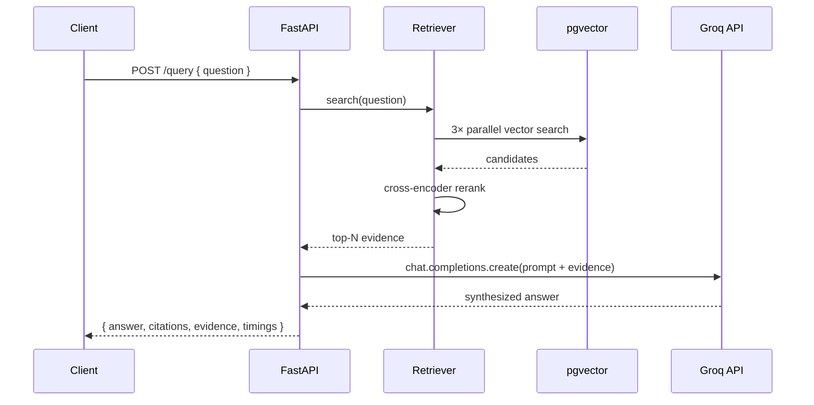

# FastAPI Plan — Multi Modal RAG Service

## Current State (Steps 1–11 Done)

| Layer | Script | What it does | DB Table |
|---|---|---|---|
| Text extraction | [chunk-text.py](file:///c:/Users/ASUS/Desktop/Multi%20Modal%20Rag/scripts/text-extraction/chunk-text.py) | PDF → text chunks | — |
| Text ingestion | [ingest_pgvector.py](file:///c:/Users/ASUS/Desktop/Multi%20Modal%20Rag/pipelines/ingest_pgvector.py) | Embed with `bge-small-en-v1.5` → pgvector | `text_chunks` (384-d) |
| Image extraction | [image-extraction-claude-new.py](file:///c:/Users/ASUS/Desktop/Multi%20Modal%20Rag/scripts/image-extraction/image-extraction-claude-new.py) | Crop figures from PDF pages | — |
| Image ingestion | [ingest_images.py](file:///c:/Users/ASUS/Desktop/Multi%20Modal%20Rag/pipelines/ingest_images.py) | Embed with SigLIP → pgvector | `image_chunks` (768-d) |
| Audio transcription | [transcribe_audio.py](file:///c:/Users/ASUS/Desktop/Multi%20Modal%20Rag/pipelines/transcribe_audio.py) | Whisper → transcript chunks | — |
| Audio ingestion | (uses `ingest_pgvector.py`) | Same embedder as text | `text_chunks` (modality='audio') |
| Fusion + Rerank | [retrieve.py](file:///c:/Users/ASUS/Desktop/Multi%20Modal%20Rag/pipelines/retrieve.py) | Parallel 3-way search → cross-encoder rerank → top-N | — |

> [!NOTE]
> All heavy logic already exists in `retrieve.py`'s `Retriever` class. The FastAPI layer wraps it, adds Groq LLM synthesis, and exposes clean HTTP endpoints.

## Build Status (Phases A–C Complete)

| Phase | Status | Notes |
|---|---|---|
| A — FastAPI core | ✅ Done | Multipart-upload ingestion, BackgroundTasks, search/query endpoints, 15 passing tests |
| B — Containerization & CI/CD | ✅ Done | Multi-stage Dockerfile, docker-compose (app + pgvector + Prometheus + Grafana), Jenkins pipeline (laptop) pushing to Docker Hub |
| C — Cloud deployment | ✅ Done | Simplified: single EC2 (m7i-flex.large) via Terraform with HCP state — EKS/RDS/ECR dropped |

---

## 1. Target Project Structure

```
multi-modal-rag/
├── app/
│   ├── __init__.py
│   ├── main.py                  # FastAPI app factory, lifespan, CORS, routers
│   ├── config.py                # Pydantic Settings (env vars, defaults)
│   ├── dependencies.py          # Shared singletons: db pool, Retriever, Groq client
│   │
│   ├── routers/
│   │   ├── __init__.py
│   │   ├── ingest.py            # POST /ingest/text, /ingest/images, /ingest/audio
│   │   ├── search.py            # POST /search  (retrieval only, no LLM)
│   │   ├── query.py             # POST /query   (retrieval + Groq LLM synthesis)
│   │   └── health.py            # GET  /health, /readiness
│   │
│   ├── schemas/
│   │   ├── __init__.py
│   │   ├── ingest.py            # Request/response models for ingestion
│   │   ├── search.py            # SearchRequest, SearchResult, SearchResponse
│   │   └── query.py             # QueryRequest, QueryResponse (with citations)
│   │
│   ├── services/
│   │   ├── __init__.py
│   │   ├── ingestion.py         # Refactored ingestion logic from ingest_*.py
│   │   ├── retrieval.py         # Thin wrapper around Retriever (conn-pool aware)
│   │   └── llm.py               # Groq chat completion + citation formatting
│   │
│   └── core/
│       ├── __init__.py
│       ├── database.py          # psycopg AsyncConnectionPool setup
│       ├── models.py            # ML model loader (lazy singleton)
│       └── metrics.py           # Prometheus instrumentation
│
├── tests/
│   ├── conftest.py
│   ├── test_ingest.py
│   ├── test_search.py
│   ├── test_query.py
│   └── test_health.py
│
├── infra/
│   ├── docker/
│   │   ├── Dockerfile           # Multi-stage: builder → slim runtime
│   │   └── docker-compose.yml   # app + postgres/pgvector + prometheus + grafana
│   ├── terraform/
│   │   ├── main.tf              # single EC2 box (HCP state)
│   │   ├── variables.tf
│   │   ├── outputs.tf
│   │   └── files/
│   │       └── setup.sh         # cloud-init: installs Docker + compose
│   └── monitoring/
│       ├── prometheus.yml
│       └── grafana/
│           └── dashboards/
│               └── rag-dashboard.json
│
├── Jenkinsfile                  # CI/CD pipeline (laptop Jenkins → Docker Hub → EC2)
├── requirements.txt
├── pyproject.toml
├── .env.example
└── README.md
```

---

## 2. API Endpoints

### 2.1 Health & Readiness

| Method | Path | Purpose |
|--------|------|---------|
| `GET` | `/health` | Liveness — returns `{"status": "ok"}` |
| `GET` | `/readiness` | Checks DB connection + models loaded |

### 2.2 Ingestion (`/ingest`)

Clients upload **raw files only** — all extraction happens server-side, and
the client never chooses between text and image pipelines.

| Method | Path | Upload | What it does |
|--------|------|--------|--------------|
| `POST` | `/ingest/pdf` | one or more `.pdf` files | For each PDF: chunks text with `scripts/text-extraction` → BGE → `text_chunks`, AND crops figures with `scripts/image-extraction` into `IMAGE_DIR` → SigLIP → `image_chunks` |
| `POST` | `/ingest/audio` | one or more audio files | Whisper transcribe → embed transcript → upserts into `text_chunks` (modality='audio') |
| `GET` | `/ingest/status/{job_id}` | — | Poll status of a long-running ingestion job |

> [!IMPORTANT]
> Ingestion is **heavy** (model inference + DB writes). It will run as a background task via `BackgroundTasks` or a task queue. The endpoint returns a `job_id` immediately with `202 Accepted`.

### 2.3 Search (`/search`)

| Method | Path | Request Body | Response |
|--------|------|-------------|----------|
| `POST` | `/search` | `{ "question": str, "k": int=10, "top_n": int=5, "modalities": ["text","image","audio"] }` | List of ranked evidence chunks with scores, source refs, modality tags |

This is **retrieval only** — no LLM call. Useful for debugging retrieval quality and for clients that want to do their own synthesis.

### 2.4 Query (`/query`)

| Method | Path | Request Body | Response |
|--------|------|-------------|----------|
| `POST` | `/query` | `{ "question": str, "k": int=10, "top_n": int=5, "model": "llama-3.3-70b-versatile" }` | `{ "answer": str, "citations": [...], "evidence": [...], "timings": {...} }` |

This is the **full pipeline**: retrieval → Groq LLM synthesis → cited answer.



---

## 3. Key Design Decisions

### 3.1 Connection Pool (not per-request connect)

The existing `Retriever._connect()` creates a new connection per search thread. We replace this with `psycopg_pool.AsyncConnectionPool` managed in the FastAPI lifespan, and inject it via dependency.

### 3.2 Model Loading (lifespan startup)

All ML models (BGE, SigLIP, cross-encoder, Whisper) are loaded **once** during app startup via FastAPI's `lifespan` context manager. They live as singletons in `app.state`.

### 3.3 Groq LLM Integration

```python
# app/services/llm.py — core pattern
from groq import Groq

async def synthesize(question: str, evidence: list[dict], model: str) -> dict:
    """Build a prompt from evidence, call Groq, return answer + citations."""
    
    # Format each piece of evidence with source metadata
    context_parts = []
    for i, e in enumerate(evidence):
        header = f"[{e['modality'].upper()} | {e['source']} p{e.get('page', '?')}]"
        context_parts.append(f"Evidence {i+1} {header}:\n{e['text']}")
    
    system_prompt = """You are an HVAC technical support assistant. 
    Answer the question using ONLY the provided evidence. 
    Cite your sources using [Evidence N] notation.
    If an image is relevant, mention it explicitly.
    If you cannot answer from the evidence, say so."""
    
    response = client.chat.completions.create(
        model=model,  # e.g. "llama-3.3-70b-versatile"
        messages=[
            {"role": "system", "content": system_prompt},
            {"role": "user", "content": f"Evidence:\n{chr(10).join(context_parts)}\n\nQuestion: {question}"}
        ],
        temperature=0.1,
        max_tokens=1024,
    )
    return {
        "answer": response.choices[0].message.content,
        "model": model,
        "usage": {"prompt_tokens": response.usage.prompt_tokens,
                  "completion_tokens": response.usage.completion_tokens},
    }
```

### 3.4 Image Serving for Citations

Images stored in `image_chunks.image_path` need to be servable. We mount a `StaticFiles` directory so the API can return URLs like `/static/images/figure_p3_fig1.png` that the client can render.

---

## 4. Build Order (Implementation Steps)

### Phase A — FastAPI Core (Steps 12–13 from Plan)

| Step | What | Files | Depends On |
|------|------|-------|------------|
| **A1** | Project scaffolding + config | `app/main.py`, `config.py`, `requirements.txt`, `.env.example` | — |
| **A2** | Database pool + health endpoints | `core/database.py`, `routers/health.py` | A1 |
| **A3** | Model loader singleton | `core/models.py`, `dependencies.py` | A1 |
| **A4** | Search endpoint (refactor `Retriever`) | `services/retrieval.py`, `schemas/search.py`, `routers/search.py` | A2, A3 |
| **A5** | Groq LLM service + query endpoint | `services/llm.py`, `schemas/query.py`, `routers/query.py` | A4 |
| **A6** | Ingestion endpoints (background tasks) | `services/ingestion.py`, `schemas/ingest.py`, `routers/ingest.py` | A2, A3 |
| **A7** | Static file serving for images | `main.py` update | A4 |
| **A8** | Tests | `tests/` | A4, A5, A6 |

### Phase B — Containerization & CI/CD

| Step | What | Files |
|------|------|-------|
| **B1** | Dockerfile (multi-stage) | `infra/docker/Dockerfile` |
| **B2** | docker-compose (app + pgvector + monitoring) | `infra/docker/docker-compose.yml` |
| **B3** | Prometheus metrics + Grafana dashboard | `core/metrics.py`, `infra/monitoring/` |
| **B4** | Jenkins pipeline (lint → test → build → push → SSH deploy) | `Jenkinsfile` |
| **B5** | Jenkins on laptop (SCM polling, credentials, Docker Hub repo) | — |

### Phase C — Single-EC2 deployment

| Step | What | Files |
|------|------|-------|
| **C1** | Terraform provisions one EC2 box (m7i-flex.large) + SG + key pair + EIP, cloud-init installs Docker | `infra/terraform/` |
| **C2** | Compose stack on the box (app + pgvector + Prometheus + Grafana) | `infra/docker/docker-compose.yml` |
| **C3** | Jenkins deploy stage → SSH → `compose pull && up -d` → health check | `Jenkinsfile` |

---

## 5. CI/CD Pipeline Flow


### Pipeline Stages (`Jenkinsfile`)

1. **Checkout** — Git SCM, `pollSCM('* * * * *')` (no webhook; laptop is behind NAT)
2. **Lint** — `ruff check app tests pipelines scripts`
3. **Test** — `pytest tests/ -v --cov=app`
4. **Build** — `docker build -f infra/docker/Dockerfile`
5. **Push** — `docker login` with the `dockerhub` credential, push SHA + `latest` tags
6. **Deploy** (main only) — SSH with `ec2-ssh-key`: scp compose file + generated `.env`, `docker compose pull && up -d`
7. **Verify** — SSH `curl /health` + `/readiness` on the box

Terraform runs separately, from the laptop — it owns the machine, Jenkins owns the app.

---

## 6. Monitoring Stack

| Tool | Role |
|------|------|
| **Prometheus** | Scrapes `/metrics` from FastAPI (via `prometheus-fastapi-instrumentator`) — request latency, error rates, active requests |
| **Grafana** | Dashboards for: API latency p50/p95/p99, retrieval vs. LLM time breakdown, ingestion job throughput, error rate by endpoint |
| **Custom metrics** | `rag_retrieval_seconds` (histogram), `rag_llm_seconds` (histogram), `rag_rerank_seconds` (histogram), `rag_ingestion_chunks_total` (counter) |

---

## 7. Environment Variables

```env
# Database
DATABASE_URL=postgresql://postgres:pw@localhost:5432/fieldnote

# Groq
GROQ_API_KEY=gsk_...
GROQ_MODEL=llama-3.3-70b-versatile

# ML Models (can override defaults)
TEXT_EMBED_MODEL=BAAI/bge-small-en-v1.5
IMAGE_EMBED_MODEL=google/siglip-base-patch16-224
RERANKER_MODEL=cross-encoder/ms-marco-MiniLM-L-6-v2
WHISPER_MODEL=small.en

# Server
HOST=0.0.0.0
PORT=8000
WORKERS=1
IMAGE_DIR=./out_images
```

---

## 8. What Gets Refactored vs. Reused

| Existing Code | Action |
|---|---|
| `Retriever` class in [pipelines/retrieve.py](file:///c:/Users/ASUS/Desktop/Multi%20Modal%20Rag/pipelines/retrieve.py) | **Refactor** — replace `_connect()` with injected pool, keep search/rerank logic intact |
| `create_table`, `save_chunks` in [pipelines/ingest_pgvector.py](file:///c:/Users/ASUS/Desktop/Multi%20Modal%20Rag/pipelines/ingest_pgvector.py) | **Reuse** — import into `services/ingestion.py` |
| `embed_images`, `embed_text` in [pipelines/ingest_images.py](file:///c:/Users/ASUS/Desktop/Multi%20Modal%20Rag/pipelines/ingest_images.py) | **Reuse** — import into `services/ingestion.py` |
| `transcribe`, `build_records` in [pipelines/transcribe_audio.py](file:///c:/Users/ASUS/Desktop/Multi%20Modal%20Rag/pipelines/transcribe_audio.py) | **Reuse** — import into `services/ingestion.py` |
| `chunk-text.py` logic | **Reuse** — `process_pdf()` imported via importlib into `services/ingestion.py` |
| `image-extraction` logic | **Reuse** — `process_pdf()` imported via importlib into `services/ingestion.py` (extraction runs server-side) |

> [!TIP]
> The CLI scripts remain working as-is for local development. The FastAPI service imports their core functions — no duplication.

---

## Open Questions — Resolved

1. **File uploads vs. paths?** → **Multipart uploads of raw files.** `/ingest/pdf` takes one or more PDFs (the backend extracts both text chunks and figures from each), `/ingest/audio` takes one or more audio files. Files are saved under `UPLOAD_DIR/<job_id>/`; extracted images go to `IMAGE_DIR` so `/static/images` can serve them.
2. **Async ingestion queue?** → **FastAPI BackgroundTasks.** Simple in-memory job tracker on `app.state.jobs` with `GET /ingest/status/{job_id}`. Swap for Redis/Celery only if volume demands it.
3. **Auth?** → **None.** Open endpoints (internal-only service).
